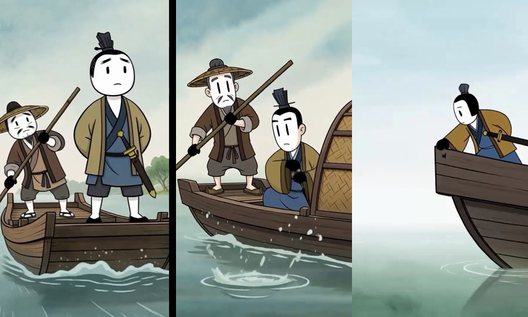

# 刻舟求剑 · Cutting a Mark on the Boat to Find the Sword

**English** | [简体中文](README.zh-CN.md)

A 30-second vertical short assembled from **three independently generated 10-second clips**: MiniMax-H3 FL2VA served by SGLang on a single 12 GB RTX 3080 Ti, three `t2va` requests, then a hard cut in an editor.

The story is the Warring States parable 《刻舟求剑》: a Chu man's bronze sword falls into the river from a moving boat; instead of looking where the boat is now, he carves a mark on the gunwale to remember where the sword went into the water.



**[▶ Watch the 30-second cut](kezhou-qiujian-30s.mp4)** — 480×864, 24 fps, 30.417 s, 6.5 MB.

| | |
|---|---|
| Finished cut | `kezhou-qiujian-30s.mp4` — H.264 480×864, 24 fps, 730 frames, **30.417 s**, AAC 44.1 kHz stereo, 6 765 192 bytes |
| Source clips | three H3 renders — H.264 480×864, 24 fps, 243 frames, **10.125 s** each, AAC 32 kHz stereo |
| Generated on | single GPU (RTX 3080 Ti 12 GB), SGLang 0.5.22 + MiniMax-H3 FL2VA, `task=t2va`, no reference images |
| Video editor | 剪映 / CapCut（待补充：版本与导出设置） |

## The nine fixed parameters

All three requests are identical except for the prompt:

| # | Parameter | Value |
|---|---|---|
| 1 | `task` | `t2va` |
| 2 | `conditions` | `[]` (pure text; no image, no audio reference) |
| 3 | `seconds` | `10` |
| 4 | `target.aspect_ratio` | `9:16` |
| 5 | `target.short_edge` | `480` |
| 6 | `num_inference_steps` | `20` |
| 7 | `flow_shift` | `12.0` |
| 8 | `audio_flow_shift` | `3.0` |
| 9 | `seed` | `1101` |

`seconds: 10` is what the API is asked for; H3 always returns **243 frames = 10.125 s**. The editor or a trim handles the 0.125 s tail if an exact 30.000 s cut is required.

## The three prompts (verbatim)

These are the exact strings sent to `/v1/videos`, one per segment. They are also stored as `segment-{1,2,3}-h3skill.txt` and, wrapped in the full request body, `segment-{1,2,3}-h3skill.json`.

Structure required by the [`h3-prompt-writing`](../../.claude/skills/h3-prompt-writing/SKILL.md) skill's T2VA mode: exactly three fields (`integrated_multimodal_description`, `overall_soundscape`, `non_diegetic_music`), **no timestamp on the first shot**, later shots introduced by increasing cut times (`At 00:03.000` / `At 00:07.000`), camera motion written as *type + amplitude + speed*, and `N/A` for non-diegetic music (the score is added in post).

### Segment 1 · 0–10 s

- characters **3043** · sha1 `959131aec5`
- job `6ab8978b-e764-4bf1-9b53-a38f2bf8c9aa` · inference **875.9 s**
- beats: Wide bow of the ferry under way; the Chu man stands with his hands clasped behind his back, the boatman poles. The sword slips out and falls; the camera tracks it down to the splash and lands back on the gunwale.

```text
integrated_multimodal_description: [Shot 1] 2D-animated, colored hand-painted scenery with stick figures, A5 historical-cartoon style, vertical 9:16 framing, Warring States Chu, a broad ink-green river under pale blue-white mist. A low-angle medium shot from the bow of a wooden ferry boat moving toward the top of the frame holds a 30–35-year-old Chu man standing at the bow with his hands clasped behind his back, his hemp robe and hem lifting in the wind. He has a round white head, a short white neck about one tenth of the head diameter, the white jaw continuing into the neck and collar with a black outline only at the sides, about four heads tall, and a head clearly narrower than his shoulders. His eyes are solid black vertical ovals, his nose a short shallow black arc, his mouth a short black line, and his eyebrows straight and slightly thick; he wears a topknot with no bangs and no beard. A deep-blue cross-collar inner robe sits under an earth-yellow hemp short jacket with a cloth belt and a hem above the knees; his bare forearms and calves are drawn with single thin black strokes, his palms are solid black ovals with one subtle thumb lobe at about eighteen percent of the head diameter and no fingers or finger gaps; he wears straw sandals and a bronze sword at his waist, the only metal glint in the frame. Behind him a 50–55-year-old boatman poles the boat: same head and neck construction, solid black vertical oval eyes, two short laugh lines at the eye corners, a slightly downturned mouth, and a short gray beard ringing the jaw without covering the neck connection; his topknot is hidden under a wide-brim bamboo hat, he wears an earth-brown coarse hemp jacket with rolled sleeves and a rope belt, his lower legs are bare, and he has straw sandals, the same black mitten-like palms, a bamboo pole, and a slight stoop. The camera pushes in with small amplitude at slow speed along the gunwale at a low angle, with wet wood, rope, and river water filling the foreground. [Shot 2] At 00:03.000, the camera cuts to a low-angle shot as the boat jolts: the bronze sword slips from its scabbard and falls vertically toward the river, turning once. The camera tracks the falling sword and tilts down with small amplitude at fast speed, keeping it on the central vertical axis while the Chu man's hand reaches too late and the boat keeps moving toward the top of the frame. [Shot 3] At 00:07.000, the camera cuts back to the same section of gunwale as the sword enters the water and a white splash bursts up into the foreground, briefly wiping across the lens; the river surface settles while the Chu man leans over the side with one black palm on the wood, staring down.

overall_soundscape: A broad river current runs under steady wind through hemp cloth, with the wooden hull creaking beneath the two men. A short metallic slip and hiss comes from the scabbard, followed by a clean splash and water droplets falling onto wet wood. Distant water birds call across the river as the surface settles.

non_diegetic_music: N/A
```

### Segment 2 · 10–20 s

- characters **3108** · sha1 `45f6e8e7f5`
- job `54644b0b-fe3c-4158-af39-a55c134de0ad` · inference **873.6 s**
- beats: He crouches, pulls a short knife and carves one horizontal notch into the gunwale. Cut to the notch in close-up, then he rises, presses a palm on the mark and points at the river.

```text
integrated_multimodal_description: [Shot 1] 2D-animated, colored hand-painted scenery with stick figures, A5 historical-cartoon style, vertical 9:16 framing, Warring States Chu, a broad ink-green river under pale blue-white mist. A medium shot at water level holds a 30–35-year-old Chu man crouching beside the gunwale of a wooden ferry boat while the white splash on the river below him disperses. He has a round white head, a short white neck about one tenth of the head diameter, the white jaw continuing into the neck and collar with a black outline only at the sides, about four heads tall, and a head clearly narrower than his shoulders. His eyes are solid black vertical ovals, his nose a short shallow black arc, his mouth a short black line, and his eyebrows straight and slightly thick; he wears a topknot with no bangs and no beard. A deep-blue cross-collar inner robe sits under an earth-yellow hemp short jacket with a cloth belt and a hem above the knees; his bare forearms are drawn with single thin black strokes, his palms are solid black ovals with one subtle thumb lobe at about eighteen percent of the head diameter and no fingers or finger gaps, and a bronze sword stays at his waist as the only metal glint in the frame. He pulls a short knife from his sleeve. Behind him a 50–55-year-old boatman stands in the background and poles the boat with a bamboo pole, shaking his head: same head and neck construction, solid black vertical oval eyes, two short laugh lines at the eye corners, a slightly downturned mouth, and a short gray beard ringing the jaw without covering the neck connection; his topknot is hidden under a wide-brim bamboo hat, he wears an earth-brown coarse hemp jacket with rolled sleeves and a rope belt, his lower legs are bare, he has straw sandals and the same black mitten-like palms, and he carries a slight stoop. The boat keeps moving toward the top of the frame while the camera pushes in with small amplitude at slow speed toward the knife. [Shot 2] At 00:03.000, the camera cuts to a close-up of the knife tip carving one horizontal notch into the gunwale, with small wood shavings curling and falling away. The notch sits on the same gunwale section and stays centered in the vertical frame, and the knife is the only sharp metal glint besides the bronze sword at his waist. [Shot 3] At 00:07.000, the camera cuts back to the Chu man as he rises and presses one black palm over the notch, pointing at the river with his other hand, certain of himself. The boatman keeps poling in the background and shakes his head again, and the camera tilts up with small amplitude at slow speed from a low angle to a level view, keeping the notch centered while the boat continues toward the top of the frame.

overall_soundscape: River water laps the wooden hull beneath steady wind over the river. A short metallic slip sounds as the knife leaves the sleeve, followed by the soft scrape of the blade cutting wood and small shavings dropping onto the deck. The bamboo pole creaks with each stroke, and one quiet exhale leaves the crouching man.

non_diegetic_music: N/A
```

### Segment 3 · 20–30 s

- characters **2782** · sha1 `2e1c8a985a`
- job `6350908b-a3ee-4bad-a5b7-7a2fc2239969` · inference **871.7 s**
- beats: The bow touches a shallow shore; he jumps in. Underwater he gropes under the notch — no sword on the riverbed. He surfaces with an empty palm; the camera rises to a high overhead wide shot and ends on a distant glint.

```text
integrated_multimodal_description: [Shot 1] 2D-animated, colored hand-painted scenery with stick figures, A5 historical-cartoon style, vertical 9:16 framing, Warring States Chu, a broad ink-green river under pale blue-white mist. The bow of a wooden ferry boat slides onto a shallow shore in a level side view, and a 30–35-year-old Chu man stands on deck pointing at one horizontal notch carved into the gunwale. He has a round white head, a short white neck about one tenth of the head diameter, the white jaw continuing into the neck and collar with a black outline only at the sides, about four heads tall, and a head clearly narrower than his shoulders. His eyes are solid black vertical ovals, his nose a short shallow black arc, his mouth a short black line, and his eyebrows straight and slightly thick; he wears a small topknot with no bangs and no beard on his chin, cheeks, or upper lip. A deep-blue cross-collar inner robe sits under an earth-yellow hemp short jacket with a cloth belt and a hem above the knees; his bare forearms and calves are drawn with single thin black strokes, his palms are solid black ovals with one subtle thumb lobe at about eighteen percent of the head diameter and no fingers or finger gaps; he wears straw sandals and a bronze sword at his waist, the only metal glint in the frame. He pushes off the gunwale and jumps into the river, and the camera tracks his jump with small amplitude at slow speed in a level side view until the splash swallows the frame. [Shot 2] At 00:03.000, the camera cuts to a low-angle underwater view in green river water: the Chu man gropes beneath the notch, his solid black vertical oval eyes open, his eyebrows straight and his mouth a short black line, bubbles rising past his white head and empty black palm. The riverbed below him is sand and small pale pebbles, and no sword lies on it. The camera holds a static shot as his hand sweeps across the sand with small amplitude at slow speed. [Shot 3] At 00:07.000, the camera cuts to the river surface as the Chu man breaks through it, wet and dripping, and holds up one empty black palm. The camera pulls out and pedestals up with large amplitude at slow speed into a high overhead view: the wooden ferry waits at the shallow shore, the ink-green river stretches away toward pale mist, and one tiny metal glint flashes at the distant center of the river. The shot ends on that distant glint and the wide river surface.

overall_soundscape: Water slaps the wooden hull as the bow touches the shallow shore under wind across the river. A jump is followed by a clean splash, then underwater bubbles and a muffled current before the surface breaks with water dripping from cloth. A single distant bird calls as the river surface settles.

non_diegetic_music: N/A
```

## How to reproduce

### 1. Serve H3

Follow [`../../README.md`](../../README.md) — build the env, download the `FL2VA/` weights, then:

```bash
cd h3 && ./serve_recipe_a.sh        # SGLang, 127.0.0.1:30010
```

Wait until `GET /health` returns `{"status":"ok"}`.

### 2. Send each segment

Every JSON file in this directory is a ready-to-post body (prompt included):

```bash
cd stickman/kezhou-qiujian
ID=$(curl -sS -X POST http://127.0.0.1:30010/v1/videos \
        -H 'Content-Type: application/json' \
        -d @segment-1-h3skill.json | python3 -c 'import json,sys;print(json.load(sys.stdin)["id"])')

# poll until status == completed
curl -sS http://127.0.0.1:30010/v1/videos/$ID

# download the mp4
curl -sS -L http://127.0.0.1:30010/v1/videos/$ID/content -o segment-1.mp4
```

Repeat with `segment-2-h3skill.json` and `segment-3-h3skill.json`. Requests run one at a time — concurrent requests on a 12 GB card run out of VRAM.

### 3. Assemble the 30 s cut

1. Create a **480×864, 24 fps** vertical project.
2. Drop the three clips in order on the timeline, butt to butt — **hard cuts only, no transition**.
3. Total length = 3 × 10.125 s ≈ 30.375 s; the exported file measured 30.417 s / 730 frames.
4. Level-match the three audio beds before export: the raw clips were quiet and uneven (mean −31.9 / −32.5 / −33.2 dB), the finished cut sits at −26.0 / −25.6 / −27.1 dB per 10 s (measured).
5. Export（待补充：剪映导出参数，如码率 / 编码档位）.

## What the parameters actually buy you

- **10 s per request** — H3 accepts 4–15 s per call, so a 30 s piece cannot be generated in one go; it has to be three calls.
- **`short_edge: 480`** — the practical tier on a 12 GB card. Measured inference was **871.7–875.9 s** per clip (38–39 s/step). A `short_edge: 736` render was also produced for segment 1 and took about 47 minutes; it is not part of this cut（待补充：是否重出 736 版本）.
- **`seed: 1101` for all three** — does not make them identical characters. With no reference image each call is independent; one earlier segment-3 render grew a beard and was regenerated with the lock restated explicitly in the shot.
- **`t2va` + `conditions: []`** — the prompts must carry everything: art style, the four-heads-tall stick-figure design, the boat, the bronze sword. That is why each prompt is 2.8–3.1 k characters long and repeats the character lock in full.

## Prompt history: two sets, one used

| Set | Files | What it is |
|---|---|---|
| Verbatim from the proposal | `segment-{1,2,3}.txt`, `segment-{1,2,3}.json`, `segment-{1,2,3}-480.json` | The three prompts exactly as written in `proposal-h3.md` §4 — four lines, including a `Negative constraints` line that the skill structure does not have |
| Skill structure (**used for this cut**) | `segment-{1,2,3}-h3skill.txt` / `.json` | Rewritten to the `h3-prompt-writing` T2VA structure; the character and prop lock is restated in full instead of saying "remain identical to Segment 1", which means nothing to an independent request |

The finished cut was spot-checked at several timestamps against both render sets (segment 1 also by a timestamp sweep with PSNR); it matches the **skill-structure** renders, not the proposal-verbatim ones.

## What this does not do

- No reference images: character consistency between segments is text-only and drifts. It is not pixel-locked.（待补充：是否引入首帧参考重出）
- The "short knife" in segment 2 renders as a blade much larger than a knife; H3 is not sensitive to the size wording.
- Audio is generated, not scored: H3 produces diegetic ambience only. Narration and music are post-production（待补充：成品是否已含旁白 / BGM）.
- The 30 s cut is 480p. There is no 736p master of the finished piece.

## Files

| File | What it is |
|---|---|
| `kezhou-qiujian-30s.mp4` | the finished 30-second cut |
| `preview.jpg` | one frame from each segment, for this README |
| `proposal-h3.md` | the shot plan and the H3-ready prompt package |
| `proposal.md` | the original story proposal (kept for reference) |
| `segment-{1,2,3}-h3skill.txt` | the three prompts sent to H3 (verbatim, in the skill structure) |
| `segment-{1,2,3}-h3skill.json` | the same prompts as ready-to-post request bodies |
| `segment-{1,2,3}.txt` / `.json` / `-480.json` | earlier prompt set, verbatim from `proposal-h3.md` §4 |
| `segment-{1,2,3}-generation.md` | per-segment generation records (job ids, timings, what came out) |

## Credits / licence

Generated with [MiniMax-H3](https://modelscope.cn/models/MiniMax/MiniMax-H3) on self-hosted hardware. Repository licence: MIT（待补充：成品与提示词的授权口径）.
